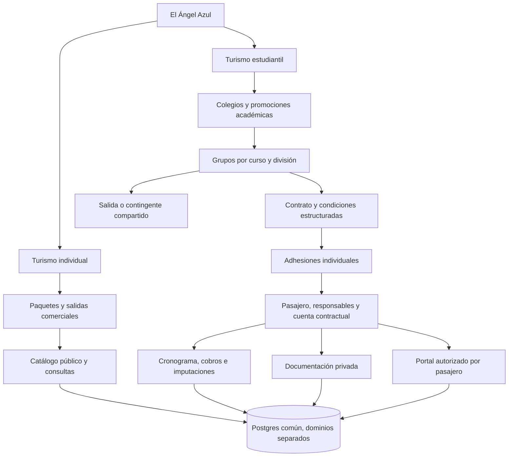

# El Ángel Azul: auditoría y desarrollo integral

Fecha de corte: 27/11/2026. Base auditada: main `893217d` (PR #35, #36 y #37 publicados). Encargo: desarrollar sobre lo existente, auditar antes de ampliar y separar catálogo comercial de operación estudiantil. Las capturas describen relaciones y flujo; no solicitan adoptar una interfaz oscura ni convertir el panel en un diagrama.

## Reglas de trabajo

La base oficial está en la cuenta del Ángel, proyecto `kfjtvazbcaypzuethxav`; `gruwkiuswpnbzywcoftz` es la base anterior de Franco y no se usa. No se accede ni escribe en ninguna durante este desarrollo. Migraciones nuevas se prueban en PGlite. Cada aplicación real y cada integración a main requiere autorización específica. No se envían correos reales ni se generan cobros de prueba en producción. No se incorporan dependencias nuevas.

## Auditoría antes del desarrollo

### Integridad de la implementación: no pasa todavía

La adhesión y el registro manual de cobros tienen persistencia y pruebas. El ecosistema completo no: el portal depende de colecciones del navegador, faltan condiciones comerciales y cuotas operativas, y hay un DTO administrativo de turismo usado como API pública. Una interfaz existente no acredita que la capacidad esté terminada.

Evaluación técnica preliminar con Impeccable, modo Operate para admin/portal y Persuade para catálogo. No es certificación WCAG ni prueba física de iPhone. El ejecutable de contexto/detector no pudo iniciarse en esta sesión; no se volvió a intentar y se trabajó con sus referencias, código y capturas ya verificadas del panel.

| Dimensión | Puntaje /4 | Evidencia y límite |
|---|---:|---|
| Accesibilidad | 3 | Etiquetas, foco, tamaños mínimos y alternativa de firma por teclado; falta auditoría de lector de pantalla y todos los estados de nuevas áreas. |
| Rendimiento | 2 | Una SPA de 9.469 líneas comparte módulos y bibliotecas entre público/admin; falta carga por área y medición de red limitada. |
| Identidad y temas | 3 | Paleta y estilos separados; quedan estilos heredados y textos/etiquetas inconsistentes. No se exige tema oscuro. |
| Adaptación | 3 | Revisión previa de nueve rutas en seis anchos; tablas densas con desplazamiento interior. No prueba gestos/Safari físicos. |
| Integridad operativa | 1 | Portal sin consulta privada y ausencia de condiciones/cuotas; publicar se valida principalmente en navegador. |
| Total | 12/20 | Funciones útiles existentes; faltan bases operativas para uso integral. |

Línea de base: `npm run check`: 182 aprobadas, 0 fallas, 1 TODO conocido de TLS. Revisión previa: 73 casos de navegador con PGlite. Son pruebas del alcance anterior, no de las nuevas capacidades.

### Hallazgos priorizados

| ID | Prioridad | Evidencia en la base auditada | Consecuencia | Corrección / criterio |
|---|---|---|---|---|
| E01 | P1 | `server.js:613`, `server.js:703`; `lib/db.js:1287` | TURISMO se lee sin sesión con la misma lista administrativa; filtrar borradores solo en JS no protege borradores. | Proyección pública en servidor, solo publicados/vigentes, sin versiones ni campos internos. HTTP anónimo nunca devuelve un borrador. |
| E02 | P1 | `assets/js/modules/persistence.js:280`, `assets/js/app.js:3124` | Pasajeros y fichas quedan en localStorage, incluso tras terminar la sesión. Riesgo en equipos compartidos. | Estado privado solo en memoria y eliminación de cachés antiguas; servidor como fuente única. |
| E03 | P0 funcional | `assets/js/app.js:7912` y `assets/js/modules/portal.js` | El portal busca DNI y contrato en colecciones del navegador; un visitante no dispone de esos datos privados. DNI/código de grupo tampoco autentican a una persona. | Acceso privado por invitación individual/identidad verificada y sesión; autorización por pasajero en cada recurso. Nunca abrir la API de pasajeros. |
| E04 | P0 funcional | `supabase/migrations/0001_init.sql:146`; `lib/db.js:1497`; `assets/js/modules/payments.js` | Plan guarda nombre y cantidad, sin importes ni fechas: no se pueden generar vencimientos ni calcular deuda contractual. | Condiciones revisadas y cronograma explícito; cuenta por pasajero con copia de condiciones aceptadas. Sin reglas financieras predeterminadas. |
| E05 | P1 | `supabase/migrations/0001_init.sql:284`, `lib/storage.js` | Hay entidad documentos pero solo se implementó la firma. No hay carga/consulta autorizada del contrato PDF o documentación. | Archivos privados, controles de tamaño/tipo y pertenencia, trazabilidad; PDF separado de datos operativos. |
| E06 | P1 | `lib/db.js:1360`, `assets/js/app.js:1521` | El navegador comprueba la publicación; el servidor admite estados activos sin asegurar contenido o precios válidos. | Validación de publicación en servidor, fechas coherentes, importes no negativos, multimedia segura. |
| E07 | P1 | `lib/db.js:33-48`, TODO en guardas | La comprobación completa del certificado Postgres sigue siendo optativa. | Corrección compatible con CA/configuración; no romper producción ni activar una bandera incompleta. Requiere coordinar variables con dueño. |
| E08 | P1 funcional | `supabase/migrations/0001_init.sql:115-146` | Grupo tiene una combinación colegio/curso/división; no hay promoción ni salida común explícita. | Distinguir promoción académica, grupo administrativo y salida/contingente. Relación adicional, sin renombrar ni destruir datos actuales. |
| E09 | P2 | `assets/js/app.js:670-691` | Un fallo al consultar catálogo se presenta como lista vacía. | Diferenciar error de carga de catálogo vacío; botón de reintento y conservar navegación. |
| E10 | P2 | `assets/js/app.js:9363` | Se sigue agregando Acceso interno al pie público, contra pedido anterior. | Quitar el enlace; entrada /admin/ conservada. |
| E11 | P2 | `docs/ARQUITECTURA.md` y secciones históricas del handoff | Documentos presentan la base anterior y capacidades no publicadas como si fueran vigentes. | Estado por fecha, base oficial identificada, historial separado de situación actual. |

Prioridad P0 indica bloqueo del alcance solicitado, no que la adhesión ya publicada esté caída. Las líneas son referencias al commit auditado; pueden cambiar durante los arreglos.

### Aspectos que se conservan

Sesiones HttpOnly/SameSite, controles de origen, separación de permisos agencia/admin en servidor, RLS sin acceso público a datos privados, consultas parametrizadas, control de versión por fila, auditoría transaccional, cobros en centavos e identificadores idempotentes. Las rutas estáticas ya restringen archivos a entradas y assets: no se identificó exposición del repositorio. Las fichas públicas no crean viajes nuevos: esa deuda antigua está corregida.

## Investigación: lo observado no define las reglas del Ángel

- [Travel Rock, preguntas frecuentes](https://www.travelrock.com.ar/preguntas-frecuentes/): describe contrato de grupo y adhesión individual posterior, y una app con cuenta para pagos. Referencia para separar acuerdo grupal, solicitud individual y acceso privado; no se trasladan sus plazos ni bonificaciones.
- [Travel Rock, documentación](https://travelrock.com.ar/documentos/): ofrece formularios distintos para espera y transferencia. Confirma que las excepciones merecen estados y procedimientos; no habilita transferir/devolver automáticamente aquí.
- [Soulmax, cuenta privada](https://soulmax.bondarea.com/?c=private&ui=mi-cuenta-27): anuncia acceso a información pre-viaje, ficha médica, pagos, contrato y notificaciones dentro de una cuenta. [Registro de responsables](https://soulmax.bondarea.com/?c=public&ui=onboarding-de-padres-12): identifica al adulto. Justifica identidad propia del responsable, no usar el código compartido de contrato como contraseña.
- [Maxdream](https://maxdream.tur.ar/): separa propuesta comercial y sucursal virtual. No se accedió a datos privados ni se dedujo su estructura interna.
- [Reglamento de Turismo Estudiantil, Resolución 1/2024](https://www.argentina.gob.ar/normativa/nacional/resoluci%C3%B3n-1-2024-402532/texto) y [publicación oficial](https://www.boletinoficial.gob.ar/detalleAviso/primera/311866/20240807): el régimen cambió respecto de referencias históricas a Cuota Cero. No se incorpora una cuota obligatoria copiada de material antiguo. La empresa debe validar su condición de operador/comercializador, garantías, documentación y términos con asesoramiento competente.
- [AAIP, derechos sobre datos personales](https://www.argentina.gob.ar/aaip/datospersonales/derechos) y [Ley 25.326 actualizada](https://www.argentina.gob.ar/normativa/nacional/64790/actualizacion): informan obligaciones sobre tratamiento, finalidad y derechos. Salud y menores requieren especial cuidado. No se confunde una propuesta de reforma con legislación vigente ni una firma dibujada con acreditación jurídica suficiente del vínculo.

## Modelo propuesto

Un monolito modular con Node/Postgres sigue siendo suficiente: no se justifican microservicios ni reemplazar el stack por moda. APIs con DTO público/administrativo/privado separados. Adiciones graduales, control de versión y auditoría preservados.

- Colegio es permanente; promoción identifica un ciclo académico, no el año de una salida por inferencia. Curso/división se vinculan a esa promoción. Grupos actuales se conservan; una salida reúne varios grupos sin mezclar sus alumnos ni reescribir colegios.
- Destino describe un lugar. Viaje/salida agrega temporada, fechas y capacidad. Paquete comercial no se convierte en contrato estudiantil.
- Contrato conserva identidad, grupo(s) admitidos, estado, versión, PDF privado, condiciones operativas y planes. El PDF es evidencia documental; nunca la única fuente para calcular cuotas.
- Solicitud y pasajero son etapas distintas. Una revisión incompleta no aprueba ni crea dos pasajeros; la cuenta económica nace de condiciones confirmadas, no de una ficha en revisión.
- Plan guarda moneda, total y fechas/importes explícitos. La cuenta del pasajero conserva una copia al confirmarla para que editar el plan futuro no cambie deudas existentes. Cronograma suma exactamente su total, en centavos enteros. Cuotas de inscripción son opcionales/configuradas, no una regla inventada.
- Cobro es movimiento confirmado/anulado; cuota es obligación. La imputación relaciona ambos; deuda total puede calcularse sin afirmar qué cuota se canceló. No aplicar mora, intereses, indexación, cambio de moneda, reintegros o asignación automática sin reglas confirmadas.
- Portal tiene identidad/sesión propia y autorizaciones por pasajero, revocables. Un responsable puede tener varios hijos. Conocer DNI o código de contrato no concede acceso. Contratos, firmas y fichas médicas permanecen privados.
- Archivos tienen dueño, finalidad, tipo, tamaño, ruta privada y estado; verificar autorización al descargar. Multimedia comercial solo es pública si el paquete está publicado. No crear una carpeta pública de documentos.
- Pasarela futura: orden de pago independiente del cobro, referencia única del proveedor, webhook autenticado/idempotente y conciliación. Nunca marcar pagado por volver de una redirección del proveedor.

## Confirmado, propuesto y pendiente de validar

| Tema | Estado | Decisión de implementación |
|---|---|---|
| Dos unidades, operación online, padre/tutor, revisión, admin/agencia | Confirmado por dueño | Conservar estos límites y permisos. |
| Catálogo con edición/publicación y consultas comerciales | Confirmado | Persistencia real y proyección pública; sin carrito ni disponibilidad inventada. |
| Contrato grupal y adhesión individual | Confirmado como flujo propuesto + observado en terceros | Separar entidades, preservar revisión y trazabilidad. |
| Promociones juntas, alumnos incorporados luego | Requisito confirmado, procedimiento no confirmado | Relaciones flexibles; no imponer cierre automático ni recargos. |
| Valores, monedas, vencimientos y matrícula | Sin reglas reales confirmadas | Campos configurables y confirmación explícita; nunca sembrar condiciones reales. |
| Imputación de cobros, descuentos, bajas, devoluciones | A validar con administración | No automatizar decisiones financieras. Diseñar transacciones reversibles y motivo. |
| Identidad de padres/tutores y autorizaciones de menores | A validar con empresa/asesoría | Acceso mínimo, invitaciones individuales, sin considerar DNI una contraseña. |
| Extracción automática del PDF | Propuesta opcional | No necesaria para operar; cualquier extracción debe revisarse. Sin dependencia o servicio nuevo aprobado no prometer OCR. |
| Pagos online, operador, comisiones y conciliación | Futuro, no confirmado | Preparar frontera de integración; no integrar un proveedor ni cobrar. |
| Política documental, retención y eliminación | A validar | Archivos privados y estados; no borrado físico automático. |

## Orden y aceptación

1. Auditoría e investigación documentadas, con evidencia y limitaciones.
2. Corregir proyección pública, validación del catálogo y privacidad local; demostrar crear/editar/publicar/despublicar desde un cliente y consultar desde otro.
3. Condiciones estructuradas, cuenta/cuotas e integridad económica; demostrar fechas/importes configurados, pagos/anulaciones y saldos sin inventar reglas.
4. Relaciones académicas y salidas compartidas, archivos privados e invitaciones; demostrar permisos por recurso y revocación.
5. Formularios y navegación por dominio; implementar los controles sobre las APIs ya verificadas. Portal privado sobre identidad propia, nunca sobre cachés del admin.
6. Verificación integrada en escritorio/celular, errores, concurrencia, documentos, persistencia y privacidad. Separar escenarios locales con dobles de servicios de verificaciones reales pendientes de configuración.

La lista anterior es el orden de ejecución, no una declaración de que esas fases ya están completas. Una prueba local no habilita automáticamente migraciones o despliegues reales.

## Implementación de cuentas — revisión local

La migración 0009 es aditiva y no aplica cargos ni transforma datos existentes. Permite configurar importes y vencimientos exactos en planes existentes, confirmar una cuenta del pasajero con una copia inmutable y registrar imputaciones manuales de pagos a cuotas. Cada operación queda auditada. Editar un plan no cambia cuentas ya confirmadas. Los pagos anulados conservan su historial y dejan de sumar tanto al saldo como a cuotas imputadas. Los excesos aparecen como saldo a favor, sin devoluciones automáticas.

El registro manual actual utiliza ARS: esta entrega mantiene ese límite explícito. No incorpora intereses, descuentos, recargos, reasignaciones, pasarelas ni aceptación legal en nombre del responsable. Confirmar una cuenta es una operación administrativa; no acredita que la familia haya aceptado condiciones. El estado de una cuota depende de la imputación explícita, por lo que un cobro sin imputar reduce el saldo general pero no marca arbitrariamente una cuota como pagada.

## Implementación de acceso privado — revisión local

La migración 0010 agrega identidades asociadas a personas o responsables existentes, invitaciones individuales de un uso y sesiones revocables. El administrador debe verificar destinatario/canal al emitir un enlace; no se envían correos automáticamente ni se usa el DNI/código de grupo como contraseña. La vigencia de invitación es configurable de 1 a 168 horas (inicialmente 24); la sesión dura ocho horas. Solo se guardan hashes de los valores de acceso. El enlace utiliza el fragmento de la URL; la interfaz lo retira después del intercambio y no lo persiste en almacenamiento web.

Un responsable consulta los pasajeros actualmente vinculados a su identidad, incluidos varios hijos. Cada lectura de cuenta, cobros o PDF comprueba pertenencia en servidor; se omiten domicilios, documentos de identidad y usuarios administrativos. Revocar invalida sesiones y enlaces vigentes, incluso ante un consumo simultáneo. Estas medidas técnicas no sustituyen la validación del procedimiento de identidad, autorizaciones de menores, privacidad y entrega de accesos por parte de El Ángel Azul.

La interfaz del portal reemplaza el acceso por DNI/código y se integra con la ficha de Pasajeros, donde el administrador genera o revoca el enlace. La familia consulta sus pasajeros, viaje, condiciones de la cuenta confirmada, vencimientos, cobros y PDF propio. No simula cobros online ni presenta botones de carga documental todavía inexistentes. Los prototipos anteriores de consulta local y «Admin portal» se retiraron del frontend. La lectura conjunta de cuentas actualiza también importes y cuotas del panel general.

La migración 0011 protege el vínculo de una cuenta confirmada con pasajero/contrato/plan/viaje y captura el nombre del plan al crearla. No se cambian ni adivinan nombres históricos. Borrar físicamente un pasajero con cuenta se reemplaza por una indicación de usar Baja; los cambios personales y de estado siguen disponibles. La corrección de acuerdos ya confirmados necesita una revisión explícita posterior, no una sobrescritura silenciosa del historial.

## Implementación académica y salidas — revisión local

La migración 0012 distingue la promoción (colegio, nivel y año de egreso) del grupo académico y de la salida/contingente operativo. Un colegio puede mantener varias promociones. Varios grupos, incluso de colegios distintos, pueden compartir una salida del mismo viaje. Un grupo puede participar en varias salidas: cada pasajero se asigna explícitamente a una de las salidas habilitadas para su grupo, sin adivinarla ni modificar contrato, cuotas o importes.

Los vínculos se validan con claves foráneas compuestas, comprobación de nivel, versiones y auditoría. Quitar una relación con pasajeros asignados se bloquea; primero se revisa su asignación. Archivar conserva las relaciones históricas. No se permite cambiar silenciosamente el colegio/nivel de una promoción vinculada ni el viaje de una salida con grupos. El portal toma las fechas de la salida concreta y muestra la promoción si fueron asignadas.

Las restricciones añadidas sobre relaciones heredadas pasajero/grupo/viaje/contrato/plan se crean `NOT VALID`: protegen nuevas escrituras y no clasifican, reparan ni borran registros viejos. Antes de la publicación corresponde revisar esos datos en lectura y validar las restricciones con autorización; las pruebas locales no acreditan que la base oficial esté libre de inconsistencias.

### Interfaz académica conectada

Grupos incorpora promociones y salidas, selección de promoción compatible con colegio/nivel, habilitación de varias salidas de un mismo viaje y asignación individual de PAX. No cambia contratos ni cuentas. Los borradores viven en memoria y sobreviven a la navegación; conflictos requieren volver a consultar y descartar explícitamente la edición. La desactivación conserva los vínculos históricos. El portal privado usa la promoción y la salida de su pasajero, incluidas sus fechas. Se verifican recorridos completos con PGlite y Chrome en escritorio y celular; no se aplicó la migración en Supabase.

### Adhesión dirigida al contrato

La migración 0013 añade un código de enlace compartido renovable y una pausa por contrato. Activar el contrato habilita su ficha cuando grupo/colegio también están activos. Ante varios contratos activos del mismo curso no se elige uno por fecha: la familia necesita el enlace correcto. La presentación pública devuelve selección y planes, nunca contratos privados ni datos personales. Se revalida la habilitación al guardar para cubrir pausas, cambios de plan o renovaciones concurrentes. El enlace compartido no sustituye el acceso individual a Mi viaje.

Se conserva el flujo preexistente de solicitud sin contrato para colegios todavía no vinculados: queda pendiente de revisión administrativa y no constituye confirmación de plaza ni de condiciones económicas. La empresa debe decidir si mantiene esa recepción de consultas/solicitudes o exige exclusivamente el enlace. No se inventa una aceptación comercial automática.
