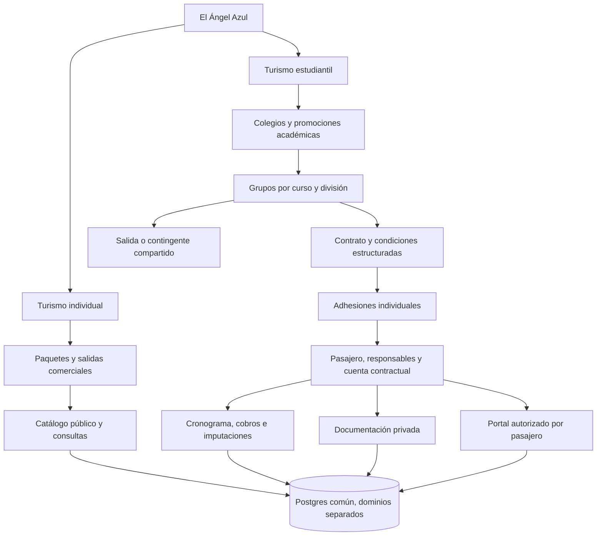

# El Ángel Azul: auditoría y desarrollo integral

Fecha de corte: 27/11/2026. Base auditada: main `893217d` (PR #35, #36 y #37 publicados). Encargo: desarrollar sobre lo existente, auditar antes de ampliar y separar catálogo comercial de operación estudiantil. Las capturas describen relaciones y flujo; no solicitan adoptar una interfaz oscura ni convertir el panel en un diagrama.

## Reglas de trabajo

La base oficial está en la cuenta del Ángel, proyecto `kfjtvazbcaypzuethxav`; `gruwkiuswpnbzywcoftz` es la base anterior de Franco y no se usa. No se accede ni escribe en ninguna durante este desarrollo. Migraciones nuevas se prueban en PGlite. Cada aplicación real y cada integración a main requiere autorización específica. No se envían correos reales ni se generan cobros de prueba en producción. No se incorporan dependencias nuevas.

## Auditoría antes del desarrollo

### Línea de base antes de estos cambios: integridad incompleta

La adhesión y el registro manual de cobros tienen persistencia y pruebas. El ecosistema completo no: el portal depende de colecciones del navegador, faltan condiciones comerciales y cuotas operativas, y hay un DTO administrativo de turismo usado como API pública. Una interfaz existente no acredita que la capacidad esté terminada.

Evaluación técnica preliminar con Impeccable, modo Operate para admin/portal y Persuade para catálogo. No es certificación WCAG ni prueba física de iPhone. El ejecutable de contexto/detector no pudo iniciarse en esta sesión; no se volvió a intentar y se trabajó con sus referencias, código y capturas ya verificadas del panel.

| Dimensión | Puntaje /4 | Evidencia y límite |
|---|---:|---|
| Accesibilidad | 3 | Etiquetas, foco, tamaños mínimos y alternativa de firma por teclado; falta auditoría de lector de pantalla y todos los estados de nuevas áreas. |
| Rendimiento | 2 | Una SPA de 9.469 líneas comparte módulos y bibliotecas entre público/admin; falta carga por área y medición de red limitada. |
| Identidad y temas | 3 | Paleta y estilos separados; quedan estilos heredados y textos/etiquetas inconsistentes. No se exige tema oscuro. |
| Adaptación | 3 | Revisión previa de nueve rutas en seis anchos; tablas densas con desplazamiento interior. No prueba gestos/Safari físicos. |
| Integridad operativa | 1 | Portal sin consulta privada y ausencia de condiciones/cuotas; publicar se valida principalmente en navegador. |
| Total | 12/20 | Funciones útiles existentes; faltan bases operativas para uso integral. |

Línea de base: `npm run check`: 182 aprobadas, 0 fallas, 1 TODO conocido de TLS. Revisión previa: 73 casos de navegador con PGlite. Son pruebas del alcance anterior, no de las nuevas capacidades.

### Hallazgos priorizados

| ID | Prioridad | Evidencia en la base auditada | Consecuencia | Corrección / criterio |
|---|---|---|---|---|
| E01 | P1 | `server.js:613`, `server.js:703`; `lib/db.js:1287` | TURISMO se lee sin sesión con la misma lista administrativa; filtrar borradores solo en JS no protege borradores. | Proyección pública en servidor, solo publicados/vigentes, sin versiones ni campos internos. HTTP anónimo nunca devuelve un borrador. |
| E02 | P1 | `assets/js/modules/persistence.js:280`, `assets/js/app.js:3124` | Pasajeros y fichas quedan en localStorage, incluso tras terminar la sesión. Riesgo en equipos compartidos. | Estado privado solo en memoria y eliminación de cachés antiguas; servidor como fuente única. |
| E03 | P0 funcional | `assets/js/app.js:7912` y `assets/js/modules/portal.js` | El portal busca DNI y contrato en colecciones del navegador; un visitante no dispone de esos datos privados. DNI/código de grupo tampoco autentican a una persona. | Acceso privado por invitación individual/identidad verificada y sesión; autorización por pasajero en cada recurso. Nunca abrir la API de pasajeros. |
| E04 | P0 funcional | `supabase/migrations/0001_init.sql:146`; `lib/db.js:1497`; `assets/js/modules/payments.js` | Plan guarda nombre y cantidad, sin importes ni fechas: no se pueden generar vencimientos ni calcular deuda contractual. | Condiciones revisadas y cronograma explícito; cuenta por pasajero con copia de condiciones aceptadas. Sin reglas financieras predeterminadas. |
| E05 | P1 | `supabase/migrations/0001_init.sql:284`, `lib/storage.js` | Hay entidad documentos pero solo se implementó la firma. No hay carga/consulta autorizada del contrato PDF o documentación. | Archivos privados, controles de tamaño/tipo y pertenencia, trazabilidad; PDF separado de datos operativos. |
| E06 | P1 | `lib/db.js:1360`, `assets/js/app.js:1521` | El navegador comprueba la publicación; el servidor admite estados activos sin asegurar contenido o precios válidos. | Validación de publicación en servidor, fechas coherentes, importes no negativos, multimedia segura. |
| E07 | P1 | `lib/db.js:33-48`, TODO en guardas | La comprobación completa del certificado Postgres sigue siendo optativa. | Corrección compatible con CA/configuración; no romper producción ni activar una bandera incompleta. Requiere coordinar variables con dueño. |
| E08 | P1 funcional | `supabase/migrations/0001_init.sql:115-146` | Grupo tiene una combinación colegio/curso/división; no hay promoción ni salida común explícita. | Distinguir promoción académica, grupo administrativo y salida/contingente. Relación adicional, sin renombrar ni destruir datos actuales. |
| E09 | P2 | `assets/js/app.js:670-691` | Un fallo al consultar catálogo se presenta como lista vacía. | Diferenciar error de carga de catálogo vacío; botón de reintento y conservar navegación. |
| E10 | P2 | `assets/js/app.js:9363` | Se sigue agregando Acceso interno al pie público, contra pedido anterior. | Quitar el enlace; entrada /admin/ conservada. |
| E11 | P2 | `docs/ARQUITECTURA.md` y secciones históricas del handoff | Documentos presentan la base anterior y capacidades no publicadas como si fueran vigentes. | Estado por fecha, base oficial identificada, historial separado de situación actual. |

Prioridad P0 indica bloqueo del alcance solicitado, no que la adhesión ya publicada esté caída. Las líneas son referencias al commit auditado; pueden cambiar durante los arreglos.

### Aspectos que se conservan

Sesiones HttpOnly/SameSite, controles de origen, separación de permisos agencia/admin en servidor, RLS sin acceso público a datos privados, consultas parametrizadas, control de versión por fila, auditoría transaccional, cobros en centavos e identificadores idempotentes. Las rutas estáticas ya restringen archivos a entradas y assets: no se identificó exposición del repositorio. Las fichas públicas no crean viajes nuevos: esa deuda antigua está corregida.

## Investigación: lo observado no define las reglas del Ángel

- [Travel Rock, preguntas frecuentes](https://www.travelrock.com.ar/preguntas-frecuentes/): describe contrato de grupo y adhesión individual posterior, y una app con cuenta para pagos. Referencia para separar acuerdo grupal, solicitud individual y acceso privado; no se trasladan sus plazos ni bonificaciones.
- [Travel Rock, documentación](https://travelrock.com.ar/documentos/): ofrece formularios distintos para espera y transferencia. Confirma que las excepciones merecen estados y procedimientos; no habilita transferir/devolver automáticamente aquí.
- [Soulmax, cuenta privada](https://soulmax.bondarea.com/?c=private&ui=mi-cuenta-27): anuncia acceso a información pre-viaje, ficha médica, pagos, contrato y notificaciones dentro de una cuenta. [Registro de responsables](https://soulmax.bondarea.com/?c=public&ui=onboarding-de-padres-12): identifica al adulto. Justifica identidad propia del responsable, no usar el código compartido de contrato como contraseña.
- [Maxdream](https://maxdream.tur.ar/): separa propuesta comercial y sucursal virtual. No se accedió a datos privados ni se dedujo su estructura interna.
- [Reglamento de Turismo Estudiantil, Resolución 1/2024](https://www.argentina.gob.ar/normativa/nacional/resoluci%C3%B3n-1-2024-402532/texto) y [publicación oficial](https://www.boletinoficial.gob.ar/detalleAviso/primera/311866/20240807): el régimen cambió respecto de referencias históricas a Cuota Cero. No se incorpora una cuota obligatoria copiada de material antiguo. La empresa debe validar su condición de operador/comercializador, garantías, documentación y términos con asesoramiento competente.
- [AAIP, derechos sobre datos personales](https://www.argentina.gob.ar/aaip/datospersonales/derechos) y [Ley 25.326 actualizada](https://www.argentina.gob.ar/normativa/nacional/64790/actualizacion): informan obligaciones sobre tratamiento, finalidad y derechos. Salud y menores requieren especial cuidado. No se confunde una propuesta de reforma con legislación vigente ni una firma dibujada con acreditación jurídica suficiente del vínculo.

## Modelo propuesto

Un monolito modular con Node/Postgres sigue siendo suficiente: no se justifican microservicios ni reemplazar el stack por moda. APIs con DTO público/administrativo/privado separados. Adiciones graduales, control de versión y auditoría preservados.

- Colegio es permanente; promoción identifica un ciclo académico, no el año de una salida por inferencia. Curso/división se vinculan a esa promoción. Grupos actuales se conservan; una salida reúne varios grupos sin mezclar sus alumnos ni reescribir colegios.
- Destino describe un lugar. Viaje/salida agrega temporada, fechas y capacidad. Paquete comercial no se convierte en contrato estudiantil.
- Contrato conserva identidad, grupo(s) admitidos, estado, versión, PDF privado, condiciones operativas y planes. El PDF es evidencia documental; nunca la única fuente para calcular cuotas.
- Solicitud y pasajero son etapas distintas. Una revisión incompleta no aprueba ni crea dos pasajeros; la cuenta económica nace de condiciones confirmadas, no de una ficha en revisión.
- Plan guarda moneda, total y fechas/importes explícitos. La cuenta del pasajero conserva una copia al confirmarla para que editar el plan futuro no cambie deudas existentes. Cronograma suma exactamente su total, en centavos enteros. Cuotas de inscripción son opcionales/configuradas, no una regla inventada.
- Cobro es movimiento confirmado/anulado; cuota es obligación. La imputación relaciona ambos; deuda total puede calcularse sin afirmar qué cuota se canceló. No aplicar mora, intereses, indexación, cambio de moneda, reintegros o asignación automática sin reglas confirmadas.
- Portal tiene identidad/sesión propia y autorizaciones por pasajero, revocables. Un responsable puede tener varios hijos. Conocer DNI o código de contrato no concede acceso. Contratos, firmas y fichas médicas permanecen privados.
- Archivos tienen dueño, finalidad, tipo, tamaño, ruta privada y estado; verificar autorización al descargar. Multimedia comercial solo es pública si el paquete está publicado. No crear una carpeta pública de documentos.
- Pasarela futura: orden de pago independiente del cobro, referencia única del proveedor, webhook autenticado/idempotente y conciliación. Nunca marcar pagado por volver de una redirección del proveedor.

## Confirmado, propuesto y pendiente de validar

| Tema | Estado | Decisión de implementación |
|---|---|---|
| Dos unidades, operación online, padre/tutor, revisión, admin/agencia | Confirmado por dueño | Conservar estos límites y permisos. |
| Catálogo con edición/publicación y consultas comerciales | Confirmado | Persistencia real y proyección pública; sin carrito ni disponibilidad inventada. |
| Contrato grupal y adhesión individual | Confirmado como flujo propuesto + observado en terceros | Separar entidades, preservar revisión y trazabilidad. |
| Promociones juntas, alumnos incorporados luego | Requisito confirmado, procedimiento no confirmado | Relaciones flexibles; no imponer cierre automático ni recargos. |
| Valores, monedas, vencimientos y matrícula | Sin reglas reales confirmadas | Campos configurables y confirmación explícita; nunca sembrar condiciones reales. |
| Imputación de cobros, descuentos, bajas, devoluciones | A validar con administración | No automatizar decisiones financieras. Diseñar transacciones reversibles y motivo. |
| Identidad de padres/tutores y autorizaciones de menores | A validar con empresa/asesoría | Acceso mínimo, invitaciones individuales, sin considerar DNI una contraseña. |
| Extracción automática del PDF | Propuesta opcional | No necesaria para operar; cualquier extracción debe revisarse. Sin dependencia o servicio nuevo aprobado no prometer OCR. |
| Pagos online, operador, comisiones y conciliación | Futuro, no confirmado | Preparar frontera de integración; no integrar un proveedor ni cobrar. |
| Política documental, retención y eliminación | A validar | Archivos privados y estados; no borrado físico automático. |

## Orden y aceptación

1. Auditoría e investigación documentadas, con evidencia y limitaciones.
2. Corregir proyección pública, validación del catálogo y privacidad local; demostrar crear/editar/publicar/despublicar desde un cliente y consultar desde otro.
3. Condiciones estructuradas, cuenta/cuotas e integridad económica; demostrar fechas/importes configurados, pagos/anulaciones y saldos sin inventar reglas.
4. Relaciones académicas y salidas compartidas, archivos privados e invitaciones; demostrar permisos por recurso y revocación.
5. Formularios y navegación por dominio; implementar los controles sobre las APIs ya verificadas. Portal privado sobre identidad propia, nunca sobre cachés del admin.
6. Verificación integrada en escritorio/celular, errores, concurrencia, documentos, persistencia y privacidad. Separar escenarios locales con dobles de servicios de verificaciones reales pendientes de configuración.

La lista anterior es el orden de ejecución, no una declaración de que esas fases ya están completas. Una prueba local no habilita automáticamente migraciones o despliegues reales.

## Implementación de cuentas — revisión local

La migración 0009 es aditiva y no aplica cargos ni transforma datos existentes. Permite configurar importes y vencimientos exactos en planes existentes, confirmar una cuenta del pasajero con una copia inmutable y registrar imputaciones manuales de pagos a cuotas. Cada operación queda auditada. Editar un plan no cambia cuentas ya confirmadas. Los pagos anulados conservan su historial y dejan de sumar tanto al saldo como a cuotas imputadas. Los excesos aparecen como saldo a favor, sin devoluciones automáticas.

El registro manual actual utiliza ARS: esta entrega mantiene ese límite explícito. No incorpora intereses, descuentos, recargos, reasignaciones, pasarelas ni aceptación legal en nombre del responsable. Confirmar una cuenta es una operación administrativa; no acredita que la familia haya aceptado condiciones. El estado de una cuota depende de la imputación explícita, por lo que un cobro sin imputar reduce el saldo general pero no marca arbitrariamente una cuota como pagada.

## Implementación de acceso privado — revisión local

La migración 0010 agrega identidades asociadas a personas o responsables existentes, invitaciones individuales de un uso y sesiones revocables. El administrador debe verificar destinatario/canal al emitir un enlace; no se envían correos automáticamente ni se usa el DNI/código de grupo como contraseña. La vigencia de invitación es configurable de 1 a 168 horas (inicialmente 24); la sesión dura ocho horas. Solo se guardan hashes de los valores de acceso. El enlace utiliza el fragmento de la URL; la interfaz lo retira después del intercambio y no lo persiste en almacenamiento web.

Un responsable consulta los pasajeros actualmente vinculados a su identidad, incluidos varios hijos. Cada lectura de cuenta, cobros o PDF comprueba pertenencia en servidor; se omiten domicilios, documentos de identidad y usuarios administrativos. Revocar invalida sesiones y enlaces vigentes, incluso ante un consumo simultáneo. Estas medidas técnicas no sustituyen la validación del procedimiento de identidad, autorizaciones de menores, privacidad y entrega de accesos por parte de El Ángel Azul.

La interfaz del portal reemplaza el acceso por DNI/código y se integra con la ficha de Pasajeros, donde el administrador genera o revoca el enlace. La familia consulta sus pasajeros, viaje, condiciones de la cuenta confirmada, vencimientos, cobros y PDF propio. No simula cobros online ni presenta botones de carga documental todavía inexistentes. Los prototipos anteriores de consulta local y «Admin portal» se retiraron del frontend. La lectura conjunta de cuentas actualiza también importes y cuotas del panel general.

La migración 0011 protege el vínculo de una cuenta confirmada con pasajero/contrato/plan/viaje y captura el nombre del plan al crearla. No se cambian ni adivinan nombres históricos. Borrar físicamente un pasajero con cuenta se reemplaza por una indicación de usar Baja; los cambios personales y de estado siguen disponibles. La corrección de acuerdos ya confirmados necesita una revisión explícita posterior, no una sobrescritura silenciosa del historial.

## Implementación académica y salidas — revisión local

La migración 0012 distingue la promoción (colegio, nivel y año de egreso) del grupo académico y de la salida/contingente operativo. Un colegio puede mantener varias promociones. Varios grupos, incluso de colegios distintos, pueden compartir una salida del mismo viaje. Un grupo puede participar en varias salidas: cada pasajero se asigna explícitamente a una de las salidas habilitadas para su grupo, sin adivinarla ni modificar contrato, cuotas o importes.

Los vínculos se validan con claves foráneas compuestas, comprobación de nivel, versiones y auditoría. Quitar una relación con pasajeros asignados se bloquea; primero se revisa su asignación. Archivar conserva las relaciones históricas. No se permite cambiar silenciosamente el colegio/nivel de una promoción vinculada ni el viaje de una salida con grupos. El portal toma las fechas de la salida concreta y muestra la promoción si fueron asignadas.

Las restricciones añadidas sobre relaciones heredadas pasajero/grupo/viaje/contrato/plan se crean `NOT VALID`: protegen nuevas escrituras y no clasifican, reparan ni borran registros viejos. Antes de la publicación corresponde revisar esos datos en lectura y validar las restricciones con autorización; las pruebas locales no acreditan que la base oficial esté libre de inconsistencias.

### Interfaz académica conectada

Grupos incorpora promociones y salidas, selección de promoción compatible con colegio/nivel, habilitación de varias salidas de un mismo viaje y asignación individual de PAX. No cambia contratos ni cuentas. Los borradores viven en memoria y sobreviven a la navegación; conflictos requieren volver a consultar y descartar explícitamente la edición. La desactivación conserva los vínculos históricos. El portal privado usa la promoción y la salida de su pasajero, incluidas sus fechas. Se verifican recorridos completos con PGlite y Chrome en escritorio y celular; no se aplicó la migración en Supabase.

### Adhesión dirigida al contrato

La migración 0013 añade un código de enlace compartido renovable y una pausa por contrato. Activar el contrato habilita su ficha cuando grupo/colegio también están activos. Ante varios contratos activos del mismo curso no se elige uno por fecha: la familia necesita el enlace correcto. La presentación pública devuelve selección y planes, nunca contratos privados ni datos personales. Se revalida la habilitación al guardar para cubrir pausas, cambios de plan o renovaciones concurrentes. El enlace compartido no sustituye el acceso individual a Mi viaje.

Se conserva el flujo preexistente de solicitud sin contrato para colegios todavía no vinculados: queda pendiente de revisión administrativa y no constituye confirmación de plaza ni de condiciones económicas. La empresa debe decidir si mantiene esa recepción de consultas/solicitudes o exige exclusivamente el enlace. No se inventa una aceptación comercial automática.

La interfaz del contrato permite compartir, pausar y renovar el enlace. La familia revisa viaje/colegio/curso/contrato antes de abrir la ficha. El enlace viaja con el formulario para que no se sustituya el contrato por una búsqueda textual posterior. El recorrido de navegador crea el enlace en el panel, envía una ficha completa con firma y verifica los cuatro vínculos persistidos, además de pausas, renovación, conflictos y formatos de celular.

### Documentos privados separados de condiciones

Se amplía la tabla documentos existente con vínculos reales a contratos/PAX, sin migrar ni interpretar archivos heredados automáticamente. El contrato firmado se adjunta como PDF, mientras las condiciones de planes siguen siendo datos estructurados. Nuevos archivos conservan contenido, pertenencia y hash; las correcciones se adjuntan como nuevas versiones y los estados de revisión quedan auditados. No hay borrado desde el panel.

Los archivos pasan por servidor y bucket privado, sin URL pública o firmada transferible. Cada descarga vuelve a comprobar sesión/pertenencia y se registra. Las familias ven sus archivos habilitados y contratos aprobados compartidos explícitamente por el operador; los contratos empiezan privados. Un recibo adjunto no registra ni confirma un pago. La subida se limita a 5 MB y PDF/JPG/PNG, con procesamiento limitado en tiempo/memoria y concurrencia; no equivale a antivirus ni a validación jurídica de un contrato. La historia se pagina.

Los reintentos comparten identificador y no sobrescriben archivos. Se limpian intentos fallidos antes de confirmar; si se pierde la respuesta del COMMIT se conserva el objeto para no romper un registro posiblemente guardado. Un corte abrupto entre objeto y metadatos puede dejar un objeto privado sin referencia: antes de operar se necesita un proceso autorizado de conciliación y una política de conservación de documentos de menores, junto con revisión de las políticas reales del bucket. Las pruebas usan almacenamiento falso/PGlite; no se inspeccionaron ni alteraron archivos reales.

La interfaz incorpora carga y revisión en contrato/perfil, y carga/consulta en el portal propio. Conserva selecciones y revisiones en memoria ante fallos y las borra al salir; reintenta con el mismo identificador después de perder una respuesta. La visibilidad de un contrato requiere confirmación explícita del operador antes de compartirlo con sus familias. La foto de celular se prepara en el navegador para su carga, sin alterar el archivo original. El estado de cada documento no cambia automáticamente el estado general del pasajero: la empresa aún debe definir qué documentación exige cada contrato.

### Responsables adicionales y verificación

La revisión detectó que guardar la ficha plana del PAX reemplazaba todos sus responsables y que una solicitud pública pendiente podía incorporarse como tutor. Se conserva la edición del principal y los demás vínculos; una nueva solicitud solo se vincula tras verificación administrativa explícita, al pasajero y viaje elegidos. «Revisada» significa vínculo confirmado por el operador, no comprobación automática de identidad ni validación jurídica. Una solicitud adicional permite autorizar otro viaje del mismo alumno sin extender derechos silenciosamente.

Al observar/rechazar una solicitud se retira únicamente el vínculo originado en ella; se preservan relaciones principales o manuales independientes. Los accesos privados consultan relaciones vigentes. La migración 0015 no revoca ni declara verificados vínculos heredados: requieren revisión autorizada antes de publicar el portal. También verifica que no haya más de un responsable principal por pasajero; ante duplicados debe detenerse para resolverlos con la empresa.

La revisión del panel ofrece selección del viaje, verificación explícita, estado y observaciones. El borrador conserva su versión original incluso después de volver a consultar: no adquiere silenciosamente una versión nueva para sobrescribir otra revisión. Se conserva ante fallos y se descarta explícitamente. Al probar dos viajes del mismo alumno se detectó y corrigió la selección del perfil por DNI: la ficha y los accesos desde Pagos ahora usan el identificador del pasajero/viaje. El perfil muestra únicamente tutores verificados para ese viaje. La exportación toma datos de adhesión del mismo viaje y el nombre del plan confirmado.

### Catálogo operativo y recursos de borrador

La migración 0016 incorpora servicios de alojamiento/transporte/comidas, disponibilidad, cupos informativos, promoción escrita por el operador, video y archivo de paquetes. No crea reservas ni descuenta cupos automáticamente; no calcula descuentos o condiciones comerciales. Los videos admiten enlaces de YouTube/Vimeo validados y normalizados para el reproductor, sin código incrustado libre.

Las fotografías se cargan a un bucket privado y se relacionan con paquetes mediante FK. Se entregan por una ruta del sitio, sin URL de Supabase o credenciales. El visitante solo accede a una foto cuando tiene al menos un paquete publicado y vigente que la usa. El administrador puede previsualizar borradores. La revalidación de caché comprueba primero la visibilidad, de modo que un ETag no elude una despublicación. Archivar conserva datos; duplicar genera un borrador restaurado y reutiliza la foto. Las fechas comerciales cambian de día en Argentina. Pruebas con PGlite/objetos ficticios; migración sin aplicar oficialmente.

El editor incorpora servicios, cupos, promoción, video, carga de fotos desde dispositivo y archivo/restauración. La carga conserva textos escritos mientras espera una respuesta y reutiliza el identificador si esa respuesta se pierde. Compartir la preparación de archivos no mezcla los buckets ni las autorizaciones de documentos privados y fotos de catálogo. WebP se convierte en JPEG; el archivo original no se modifica. La portada respeta la foto principal, la duración distingue noches de días y los filtros invertidos muestran cómo corregirlos. La navegación vuelve a consultar el catálogo para no mantener precios anteriores en la misma sesión. El reproductor externo se carga solo tras la acción del visitante.

### Certificado de la base

Se elimina la conexión con certificado sin verificar. La política segura se aplica también sin bandera y no admite que parámetros SSL de la URL la reemplacen. Se conserva una CA opcional cargada por el dueño en Hostinger. La prueba usa exclusivamente configuración ficticia en memoria: comprobar el certificado del proveedor y la conectividad real sigue siendo una condición previa al despliegue autorizado.

### Requisitos y comunicaciones por contrato

Cada contrato puede elegir los tipos de documentos que requiere y redactar avisos privados, sin predeterminar requisitos de menores. El portal muestra únicamente avisos publicados del contrato actual y distingue documentación faltante, pendiente, observada o aprobada a partir de archivos visibles. La aprobación de un documento la decide el operador; no registra pagos ni constituye evaluación médica o legal. Los avisos se despublican y conservan, con auditoría de cambios y conflictos por versión. La empresa debe validar sus propios requisitos, consentimiento, conservación y condiciones antes de configurarlos.

## Revisión integrada — 28/11/2026

Los apartados iniciales describen main `893217d` antes de desarrollar. Las implementaciones de abajo están reunidas en una propuesta de revisión, no en producción. No se accedió a Supabase ni se modificó Hostinger. Se volvió a consultar GitHub y main seguía en el mismo commit; no se incorporaron cambios ajenos pendientes como si estuvieran aprobados.

| Criterio | Resultado comprobado localmente | Límite antes de operar |
|---|---|---|
| Catálogo conectado | Crear, editar, publicar/despublicar, duplicar, archivar, filtros, servicios, cupos informativos, galería y video | No reserva automáticamente ni interpreta promociones como descuentos |
| Contenido vigente | Nueva consulta al navegar, cambio de precios, fechas argentinas, portada correcta y foto privada al despublicar | Revisión real de bucket/CA pendiente |
| Colegio y promociones | Promociones, divisiones, grupos, salidas compartidas y asignación explícita | Datos heredados requieren revisión autorizada |
| Contrato y adhesión | Enlace renovable/pausable, contexto propio, ficha firmada y relaciones persistidas | Empresa decide si conserva recepción de solicitudes sin contrato |
| Planes y cuotas | Importes/vencimientos configurados, centavos exactos, cuenta histórica inmutable | Registro manual solo ARS; no reasigna condiciones a cuentas confirmadas |
| Cobros y saldos | Registro/anulación con historial, imputación explícita, saldo/favor reales | Sin cobro online ni intereses, reintegros o recargos inventados |
| Responsables | Revisión explícita, viaje correcto, conservación de tutores adicionales | Revisar relaciones antiguas antes de emitir accesos reales |
| Portal privado | Identidad individual, multipasajero, cuentas, cobros, PDF, archivos, requisitos y avisos | La agencia verifica identidad/canal; no es autenticación por documento |
| Contrato firmado y documentos | Archivo privado separado de datos operativos, revisión, descarga propia y reintentos | Políticas reales, antivirus, conservación y conciliación pendientes |
| Concurrencia y errores | Versiones, bloqueo, respuesta perdida, borradores conservados, idempotencia en cobros/archivos | No prueba una caída física de Supabase ni certifica disponibilidad |
| Permisos | Agencia crea/edita sin eliminar; CONFIG privada; IDOR/CSRF y sesiones controlados en servidor | No sustituye revisión de roles/políticas del proveedor |
| Visual y acceso | Chrome local en 320/390/1440, controles legibles, foco, fuentes/paleta conservadas | Sin certificación WCAG completa ni prueba física de Safari/iPhone |

Verificación de cierre: 269 pruebas obligatorias aprobadas, cero fallas y un marcador TODO histórico de las guardas cuya aserción TLS ya pasa. Se incorporaron cuatro pruebas TLS obligatorias separadas sin alterar guardas, que requieren autorización. Los recorridos integrados de Chrome se consignan en el cierre del PR con sus cantidades; todos usan HTTP real sobre PGlite y objetos ficticios, sin servicios reales. Las pruebas verifican persistencia y relaciones SQL durante el proceso; no equivalen a una migración aplicada o una prueba del hosting.

### Decisiones y limitaciones explícitas

- La ficha registra la aceptación general existente. La cuenta confirma condiciones por el operador y conserva su versión; esto **no acredita aceptación de esos importes por la familia**. Antes de operar se debe definir con la empresa el texto, evidencia y momento de aceptación financiera y de tratamiento de datos. No se genera deuda como si hubiera consentimiento jurídico automático.
- Cambiar un acuerdo ya confirmado exige un proceso específico de rectificación con historia; esta propuesta bloquea sustituciones silenciosas. Falta validar reglas de cambios de viaje, bajas, transferencias, devoluciones, mora y monedas adicionales.
- Extraer datos del PDF puede preparar un borrador revisable, pero OCR/IA no es necesario para operar y no se activó ningún servicio ni dependencia. Se carga el archivo firmado y se registran condiciones estructuradas explícitas.
- El PDF heredado conserva las tildes españolas pero translitera caracteres que Helvetica no admite (por ejemplo algunos apellidos extranjeros), aunque la base conserva el original. Corregirlo requiere autorizar una dependencia de incrustación tipográfica y elegir fuentes con cobertura documentada; no se instaló ni se prometió soporte Unicode universal. Mantener este límite visible en la revisión antes de emitir documentos reales.
- El acceso a Mi viaje se comparte manualmente mediante un enlace individual de un uso. Correo automático depende de Resend/DNS; no se envían mensajes reales. La pasarela de pagos es una integración futura que debe registrar eventos verificados/idempotentes antes de incorporarlos al libro de cobros; no se simula como cobro confirmado.
- La revisión local aporta código ejecutable, controles y pruebas. La habilitación diaria en producción depende de aprobar y comprobar las migraciones, credenciales/certificados y políticas del proveedor con autorización; no se presenta como un sistema ya desplegado.

### Evidencia de navegador de la integración

| Recorrido | Casos aprobados |
|---|---:|
| Panel general y permisos de agencia | 37/37 |
| Portal, privacidad y PDF propio | 13/13 |
| Cuentas, cuotas e imputaciones | 10/10 |
| Promociones, salidas y grupos | 11/11 |
| Adhesión vinculada al contrato | 11/11 |
| Documentos privados | 11/11 |
| Tutores y dos viajes del mismo alumno | 8/8 |
| Catálogo operativo, fotos y publicación | 9/9 |
| Requisitos y avisos privados | 7/7 |
| Total de estos guiones de integración | 117/117 |

Además se verificaron en Chrome los ocho accesos directos de las áreas del panel; todos respondieron 200 y cargaron el mismo módulo operativo. Contratos abrió el editor de requisitos/avisos y Pagos cargó cuentas. Se añadió una prueba obligatoria que evita divergencias de recursos/protecciones entre las ocho entradas y el panel principal. El recorrido de localhost:3059 confirmó entrada libre, paquete ficticio visible y cero errores de página.

Los guiones están en `scripts/e2e/`, emplean el Playwright ya instalado externamente mediante PLAYWRIGHT_PATH y Chrome mediante PLAYWRIGHT_CHANNEL=chrome. No se agregó una dependencia al repositorio. E2E_FONTS=online habilita únicamente la lectura de fuentes de Google en los recorridos aislados; los demás proveedores se bloquean o se sustituyen por respuestas ficticias. El panel general usa una copia local de la biblioteca XLSX existente verificada con su hash. Ningún resultado implica pruebas sobre la base oficial.
